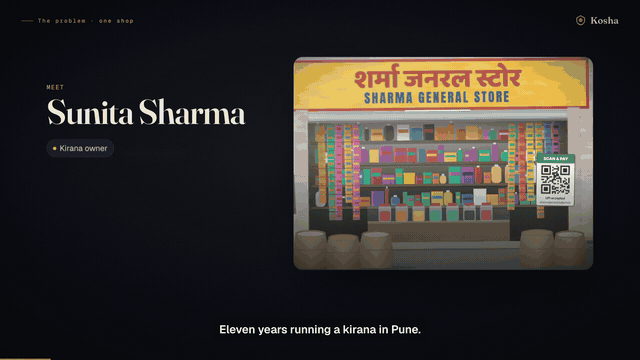
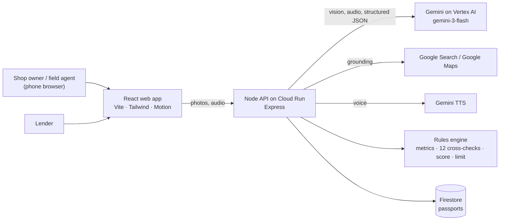

# Kosha

**The AI credit passport for every corner shop.**

<div align="center">

### ▶ See Kosha in action

<a href="docs/media/kosha-demo.mp4"></a>

<sub>2:45 narrated walkthrough · <a href="docs/media/kosha-demo.mp4"><b>Watch the full video (1080p)</b></a> · <a href="docs/media/kosha-demo.srt">Subtitles</a></sub>

</div>

---

Millions of small shops across Asia (kiranas in India, warungs in Indonesia, sari-sari stores in the Philippines) can't get formal working-capital loans. They have no audited accounts, so lenders can't see how good they are. Yet the shop already keeps everything a lender needs: a handwritten ledger, supplier bills, digital payment records and electricity bills.

Kosha reads those records with Gemini, cross-checks them against each other, scores the shop with fixed rules that can be audited, and issues a **credit passport** any lender can verify with a link or a QR code.

> *Kosha* is the word for a kingdom's treasury in Kautilya's *Arthashastra*.

## What it does

1. **Reads the handwritten ledger** (khata / buku catatan / listahan) in Devanagari, Bahasa or Taglish. Every line is translated, classified as a sale, stock bought, credit given, credit repaid or expense, and boxed on the photo.
2. **Reads the proof:** supplier bills, a UPI/QRIS statement or e-wallet screenshots, and electricity bills.
3. **Catches edited documents.** Gemini flags digits in a different font or weight, and code checks running balances between screenshots.
4. **Looks at the neighbourhood** with Gemini grounded on Google Search (or Google Maps on billed projects): schools, transport, markets and competitors.
5. **Holds a five-question voice interview** in the owner's language and checks the answers against the documents.
6. **Issues the passport:**
   - a score (300–900) built from capacity, character, conditions and stability
   - a working-capital limit sized to the shop's monthly surplus
   - a repayment schedule that follows festival seasons
   - reasons linked to the exact evidence
   - an explanation in the owner's language, read aloud with Gemini TTS
7. **Gives lenders a queue** of passports and a shareable verification page.

### Accounts, consent and who sees what
- **Shop owners** sign up, build passports, and see each lender's response on their dashboard (`/app`).
- **Lenders** sign up as *pending*. They see no shop data until Kosha staff verify their organisation; then they review the queue (`/lender`) and approve, ask for documents or decline, with a note the shop sees.
- **Kosha staff** (`/admin`) verify or reject lender organisations and read the audit log. They never see a shop's documents.
- **Consent is taken before a passport is issued.** The shop chooses *all verified lenders* or *only lenders I choose*, and whether the public link shows the offer amount. It can change or withdraw this any time from its dashboard or the passport page, and it takes effect at once.

| Who | Sees |
|---|---|
| The shop that owns the passport | Everything, every lender's decision, and an access log ("Viewed by Pune Merchants Co-op · 17 Oct") |
| A verified lender the shop shared with | The full passport and only its own organisation's decision. Every view is logged for the shop |
| A pending or rejected lender | No shop data, only a "being verified" page |
| Anyone with the link, and Kosha staff | A redacted record: shop name, owner's first name, area and city, shop type, score, band, offer status, issue date, sources count (and the offer amount only if the shop allows it) |

- One policy file, [`shared/policy.ts`](shared/policy.ts), lists every permission. The API enforces it on every request and the web app uses the same file to hide routes and buttons. The server builds the public record field by field, so redacted fields are never sent.
- One-click **demo accounts** on the sign-in page: *Sunita* (Sharma General Store), *Arjun* (Pune Merchants Co-operative Bank, a verified lender) and a subtle *Admin* button (*Meera Iyer*, Kosha Operations). The password for `shop@demo.kosha`, `lender@demo.kosha` and `admin@demo.kosha` is `kosha-demo`.
- Security: passwords are hashed with scrypt. The HTTP-only cookie holds only a random session id; sessions live on the server (Firestore on Cloud Run, `.data/sessions.json` locally), last 7 days, and role and verification are read fresh on every request. *Sign out on all devices* ends every session. State-changing requests from another site are refused, and five wrong passwords lock an email for 15 minutes. Sign-ins, lender views, decisions, consent changes and verifications go to an append-only audit log.

### Smooth on old phones and PCs
Kosha checks the device (CPU cores, memory, data saver, reduced motion) and watches the real frame rate. On a slow device it lowers the 3D quality, freezes the animated background and drops blur effects, and it stops animating whenever the tab is hidden.

### Fair and auditable by design
- Gemini **reads, translates, checks and explains**. The **score and limit come from deterministic rules** in [`server/score.ts`](server/score.ts), so the same evidence always gives the same result.
- A failed integrity check **holds** the offer whatever the score.
- The limit uses a prudent margin (at most 25%) and keeps the instalment under 35% of monthly surplus.
- The interview never judges accent, tone or confidence. It only compares facts with documents.
- Kosha pre-screens; a lender makes the final decision.

## Architecture



| Step | Gemini call | Output |
|---|---|---|
| Ledger | Vision, JSON schema | Every line: date, original text, English, type, amount, bounding box |
| Supplier bills | Vision, JSON schema | Supplier, date, total, items, credit terms, tamper signs |
| Payments | Vision (image or PDF) | Daily totals, payers, balances, tamper flags with boxes |
| Electricity | Vision | Month, kWh, amount, paid on time |
| Shopfront | Vision | Signboard text, matches the shop name, stock level |
| Neighbourhood | Search or Maps grounding | Demand drivers, competitors, distance, bearing |
| Interview | Audio | Transcript, translation, facts |
| Passport | Text, JSON schema | Reasons, owner explanation, festival seasonality, loan-purpose return |

A full passport takes about 10 Gemini calls and costs a few US cents.

## Run it locally

```bash
cp .env.example .env          # add a GEMINI_API_KEY from AI Studio
npm install
npm run dev                   # API on :8080, web on :5173
```

Open http://localhost:5173 and choose a sample shop (this signs you in to the demo shop account), or sign in as the demo lender at `/login`. The two sample shops are fictional; their documents are in [`public/samples`](public/samples). Their Gemini results are cached in [`cache/`](cache), so the demo also works offline.

- **Sharma General Store** (Pune, India): Hindi ledger, UPI statement. Gets an offer.
- **Nena's Sari-Sari Store** (Quezon City, Philippines): Taglish ledger. One wallet screenshot was edited to add ₱48,000, so the passport is **held**.

End-to-end test in real Chrome: `node scripts/e2e.mjs 0` (or `1` for the second shop).

## Deploy to Cloud Run

```bash
PROJECT_ID=your-project ./deploy.sh
```

This enables Cloud Run, Vertex AI and Firestore, creates a least-privilege service account, and deploys the single container (web app and API) to `asia-southeast1`.

## Project layout

| Path | What |
|---|---|
| `src/` | React app: guided six-step flow, passport card, lender view |
| `server/` | API: Gemini calls (`gemini.ts`, `extract.ts`, `location.ts`, `interview.ts`, `tts.ts`), rules (`score.ts`), passport assembly (`assess.ts`) |
| `shared/` | Types and interview questions shared by both |
| `public/samples/` | Sample shop documents (fictional) and their generator in `scripts/samples/kosha` |
| `cache/` | Cached Gemini results for the sample shops |

UI components from [Unlumen UI](https://ui.unlumen.com) and [Smooth UI](https://smoothui.dev).
